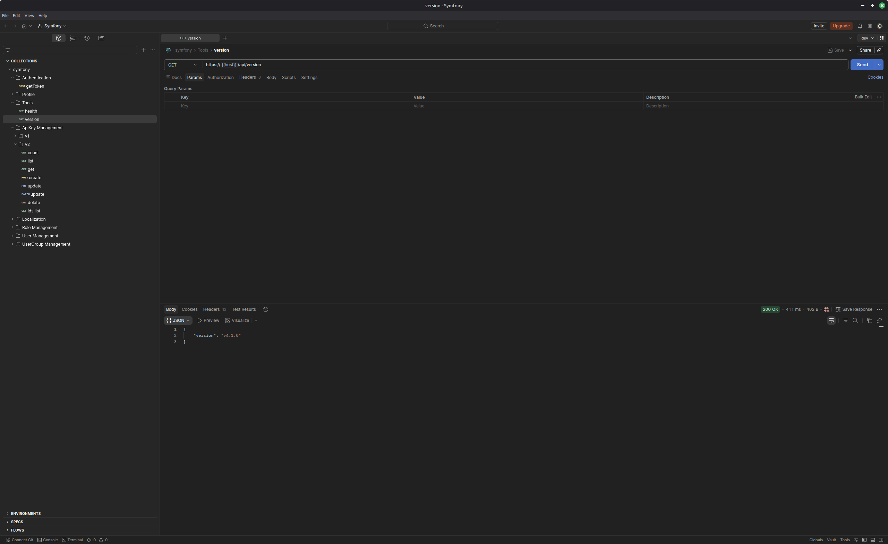

# API Testing with Postman
This document describes how to configure and use [Postman](https://www.postman.com/) to interact with and test our application's API.

## Setup Guide

1. Install Postman

   Download and install the desktop client from the [official website](https://www.postman.com/downloads/).

2. Import Collection and Environment
   * Open Postman and select `File` -> `Import...` menu item.
   * Navigate to the project's [postman](postman) directory.
   * Import the provided files (you should typically import both the API Collection `*.postman_collection.json` and the Environment variables `*.postman_environment.json`).

3. Select the Environment
   
   In the top right corner of the Postman interface, select the `dev` environment from the environment dropdown menu.

## Authentication (Access Tokens)
To call protected API endpoints, you must be authenticated.

1. Create an `admin` account using the console command `./bin/console user:create` (described in [commands.md](commands.md)).
2. In Postman, open the `Authentication` -> `getToken` collection request. Set the `admin` user password (created in the previous step) and execute it to generate a token.
3. Open the `Environments` tab in the bottom-left corner and select the `dev` environment.
4. Update the `Value` of the `token` variable with the token you just received.
5. You are now able to use other endpoints in the collection. Postman will automatically use this token for authentication.

