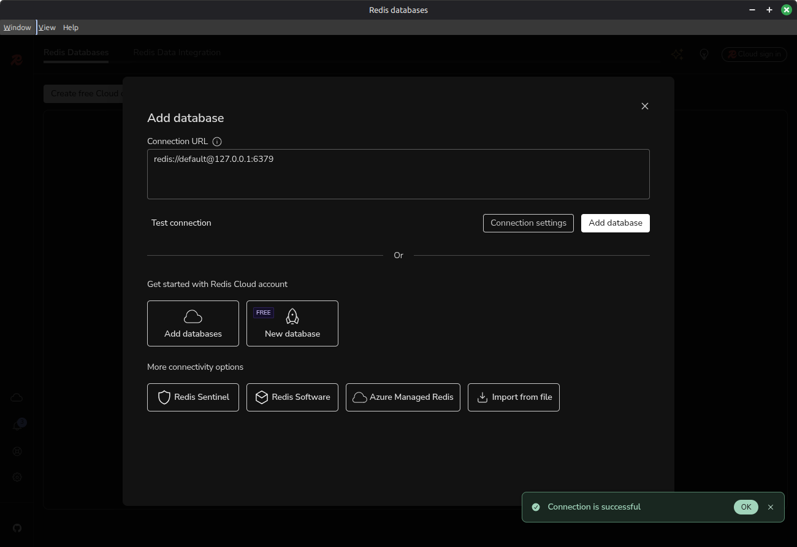
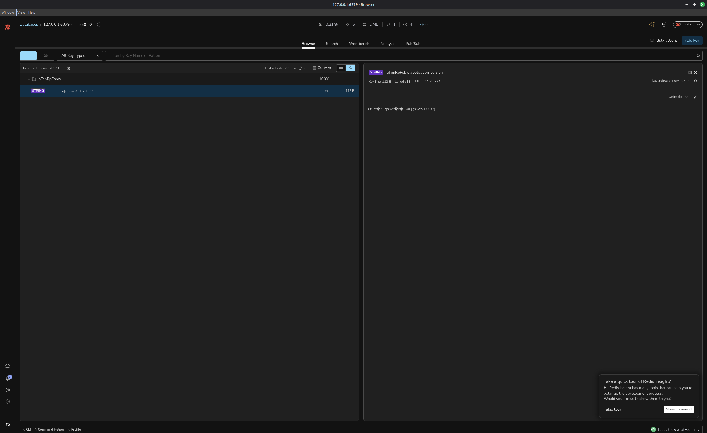

# Redis GUI (RedisInsight)
This document describes how to configure and use [RedisInsight](https://redis.com/redis-enterprise/redis-insight/) as a graphical interface for managing and inspecting our local Redis database.

## Setup Guide

1. Install RedisInsight

   Download and install the desktop client from the [official website](https://redis.com/redis-enterprise/redis-insight/) or install it via your operating system's package manager.

2. Create a New Connection

   Open RedisInsight and add a new database connection pointing to your local Docker environment. By default, you should use the following parameters:
   * Host: `127.0.0.1` (or `localhost`)
   * Port: `6379`

   

3. Browse the Database

   Once connected, you can select the target database (typically `db0`) from the left sidebar to browse, search, and modify the stored keys.

   
